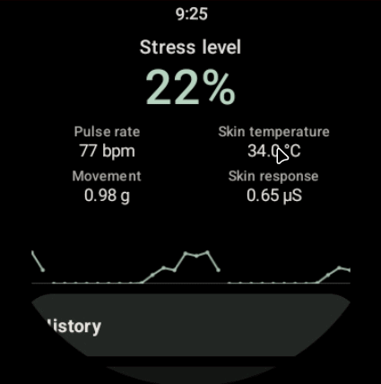

# Wear OS App for Stress Detection

com

[Technical details](outputs/technical_details.md) | [Training results](outputs/training_results.md)

<p align="center">
  
</p>

## Build and run

Requires Python 3.11, JDK 17 and Android SDK 34 with Build Tools 34.0.0.

Clone the repository, then download `physio-model-assets-v1.zip` and `SHA256SUMS` from [**Releases**](https://github.com/Shade9378/physio-stress-det/releases/tag/pretrained-models-v1). From the project root:

```sh
python scripts/model_assets.py install --archive /path/to/physio-model-assets-v1.zip --checksum /path/to/SHA256SUMS
cd android
./gradlew :app:assembleDebug
```

Use `gradlew.bat` on Windows. Install the matching APK from `results/build/android/app/outputs/apk/debug/`. Open **Stress Detection** and tap **Start**; allow 60 seconds for the first prediction. No training or dataset is required.

## Samsung sensors (optional)

Download [Samsung Health Sensor SDK 1.4.1](https://developer.samsung.com/health/sensor/overview.html) and install it from the project root before building:

```sh
python scripts/setup_wear_tools.py --samsung-archive /path/to/samsung-health-sensor-sdk-v1.4.1.zip
```

Requires Health Sensor Service 1.6.5+, sensor permission and [developer mode](https://developer.samsung.com/health/sensor/guide/developer-mode.html) for testing. Distribution requires Samsung partner approval.

**!!! NOTE:** Without the SDK, live detection uses acceleration only.

## Training and replay (optional)

Place WESAD in `data/WESAD/WESAD/` and install Python dependencies:

```sh
python -m pip install --require-hashes -r requirements.lock
```

**Replay:** with release models installed, run `python scripts/export_wear_assets.py --replay-only`, rebuild the APK, then select **Replay**.

**Train (prepared replay):**

```sh
python scripts/preprocessing.py
python scripts/train_model.py
```

Outputs go to `results/`; models, replay data and SDK binaries are Git-ignored.

## Limitations

- Evaluated on WESAD; real-world watch accuracy is unvalidated.
- Available sensors vary by watch.
- Performance measurements use an emulator or computer, not a physical watch.
