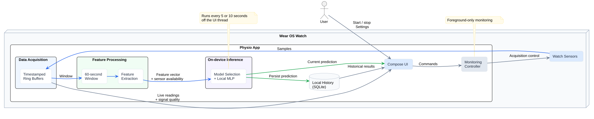

# Technical details

[Setup](../README.md#build-and-run) | [Training results](training_results.md)

## App

Inference runs every 5 or 10 seconds, off the UI thread. Monitoring stops when the app leaves the foreground.

Replay mode for testing uses supplied WESAD windows and actual on-watch inference.

## Sensors

| Signal | Acquisition | Model handling |
|---|---|---|
| Accelerometer (ACC) | Standard Android SensorManager | Required; six magnitude-based movement features at 16 Hz |
| Raw green PPG | Optional Samsung SDK | Five pulse features from 25 Hz PPG; BPM is not a substitute |
| EDA | Optional Samsung SDK | Seven features from 1 Hz conductance in microsiemens |
| Skin temperature (TEMP) | Optional Samsung SDK | Seven features from 1 Hz temperature in Celsius |
| Heart rate (BPM) | Wear OS Health Services | Display only |

Samsung SDK 1.4.1 supports PPG on compatible Watch4+, skin temperature on Watch5+, and EDA on Watch8+. Runtime capabilities, firmware, permissions and signal quality determine availability; requires Health Sensor Service 1.6.5+ and developer access or partner registration.

ACC is mandatory; a separately trained subset model is selected if any optional signal is missing, stale or invalid. Streams use bounded interpolation; long gaps are not filled.

SQLite retains up to 2,000 prediction summaries locally.

## Models

| Pipeline | Representation | Purpose |
|---|---|---|
| Original classical / MLP experiments | 48 physiological features | Research comparison |
| Original CNN / TCN / sensor encoders | Six channels, 960 samples at 16 Hz | Sequence-model comparison |
| Prepared WESAD replay | 6–32 features, depending on sensors | Replay and original subset experiments |
| Native live monitoring | 6–25 features, depending on sensors | Watch-rate preprocessing and sensor fallback |

The app uses supervised MLPs: standardized features -> 16-unit ReLU layer -> one sigmoid output. ACC-only has 129 parameters; all four live sensors have 433. Normalization is fitted on training subjects and included in each ONNX export.

Live preprocessing uses ACC magnitude in g; normalized, bandpass-filtered PPG; and low-pass-filtered EDA and temperature. WESAD BVP is resampled before windowing to train the watch-rate contract.

Packaged models use S2 as the held-out subject and seed 2024.

## Key files

| Path | Purpose |
|---|---|
| `scripts/preprocessing.py` | Prepare replay features; `--sensors live` for watch-rate features |
| `scripts/train_model.py` | Train replay MLPs; `--contract live` for native live models |
| `scripts/export_wear_assets.py` | Package validated models and replay assets |
| `scripts/model_assets.py` | Package, verify and install dataset-free release models |
| `scripts/setup_wear_tools.py` | Install pinned Android tools or Samsung SDK |
| `src/physio/processing/` | Dataset loading, windowing and sensor features |
| `src/physio/training/` | Supervised models and subject-grouped validation |
| `src/physio/deployment/` | ONNX export, checkpoints and watch assets |
| `src/physio/evaluation/` | Metrics and consistent figures |
| `experiments/helpers/` | Shared experiment code |
| `android/app/src/main/java/org/physio/wear/` | UI, sensors, buffers, inference and SQLite history |
| `android/app/src/samsung/java/org/physio/wear/SamsungSensors.kt` | Optional Samsung acquisition adapter |
| `configs/` | Training, deployment and live-sensor settings |
| `results/` | Local generated outputs; excluded from Git |

## Tech stack

| Role | Pinned versions |
|---|---|
| Python runtime | Python 3.11.11 |
| Data and signals | NumPy 1.26.4, Pandas 2.2.3, SciPy 1.13.1, NeuroKit2 0.2.10 |
| Training | PyTorch 2.5.1, scikit-learn 1.5.2, XGBoost 2.1.3 |
| Tracking | MLflow 2.18.0 |
| Export / host inference | ONNX 1.17.0, ONNX Runtime 1.20.1 |
| Figures | Matplotlib 3.9.2, Seaborn 0.13.2, SciencePlots 2.1.1 |
| Android build | Kotlin 1.9.25, AGP 8.7.0, Gradle 8.9, JDK 17 |
| Android target | Compile/target SDK 34; minimum SDK 30 |
| Watch UI | Compose 1.7.5, Wear Compose 1.4.0, Compose compiler 1.5.15 |
| Sensors | Health Services 1.0.0-rc02; optional Samsung SDK 1.4.1 |
| Watch inference / concurrency | ONNX Runtime Android 1.20.0, Coroutines 1.8.1 |
| Storage | Android SQLiteOpenHelper |
| Python checks | pytest 8.3.4, Ruff 0.8.4 |
